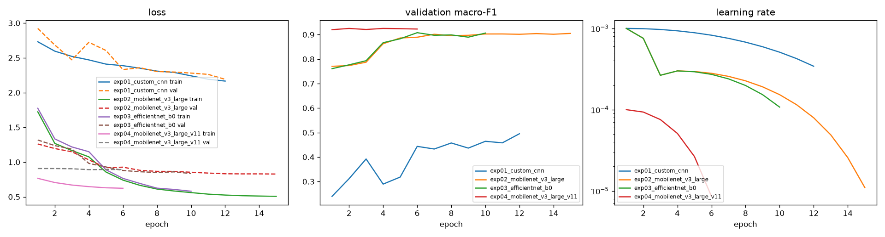
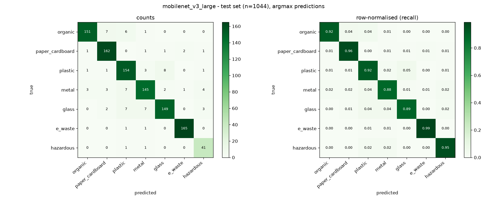

# WasteWise — ML documentation

> Every number in this document is produced by code in `ml/src` and stored in `ml/reports/`.
> Sections marked *(generated)* are copied from those report files after evaluation runs.

## 1. Problem definition

Single-image classification of one household waste item into **7 categories**:
`organic, paper_cardboard, plastic, metal, glass, e_waste, hazardous`.
An auxiliary head predicts one of 27 fine-grained item types (for example `aluminium_can` or `battery`). The UI shows it only when it is confident.
The label taxonomy and its mapping from source datasets live in `ml/src/taxonomy.py`, which is the single source of truth.

## 2. Datasets and licences

| Dataset | Use | Licence / terms |
|---|---|---|
| TrashNet (Thung & Yang) | paper, cardboard, glass, metal, plastic | MIT |
| Garbage Classification 12 (Kaggle, mostafaabla) | battery, biological, glass, paper, metal, plastic | ODbL 1.0 (database); images © original owners, research use |
| Recyclable & Household Waste (Kaggle, Alistair King) | 30 item classes, including the only aerosol-can images | Card says educational, research and non-commercial use; requires citation |
| EWasteNet (Nifulislam) | 8 electronic-device classes | No explicit licence; academic use with citation |

**Consequence:** the trained weights inherit **non-commercial / research-only** restrictions. WasteWise is an educational capstone. Commercial use would need re-licensed or self-collected data.
Raw datasets are **not** committed or copied to cloud drives. `python -m ml.src.prepare_data` rebuilds dataset v1 deterministically from the original sources.

Images from TrashNet "trash", Garbage-12 clothes/shoes/trash and household30 paper cups, clothing and shoes are held out as **out-of-distribution (OOD) probes**. They are never trained on. They measure how often the confidence threshold rejects things that are not one of the 7 categories.

## 3. Data cleaning and leakage prevention (`ml/src/prepare_data.py`)

1. **Decode check.** Every file is opened with Pillow, EXIF-transposed and converted to RGB. Unreadable files are listed in the report.
2. **Exact duplicates (MD5).** These are removed. If identical files carry conflicting labels, the file is dropped. Garbage-12's paper/plastic/metal/cardboard/glass folders turned out to be byte-identical copies of TrashNet.
3. **Near duplicates.** A 32×32 grayscale thumbnail correlation (≥ 0.97) plus a 4×4 colour-layout check finds them, and union-find joins them into groups.
   - A 64-bit dHash was tried first and rejected: centred objects on white backgrounds collapsed into huge false groups.
   - Pairs at ≥ 0.99 are collapsed to one image.
   - Groups whose members carry conflicting labels are dropped.
4. **Group-aware stratified split (70/15/15, seed 42).** A near-duplicate group always goes to a single split, so no visually identical image appears in both train and test. Notebook 01 re-checks this: *0 groups span more than one split, 0 duplicate MD5s*.
5. **Class balance.** Each category is capped at 1,100 images. `hazardous` has only 285 unique images; this gap is compensated by inverse-frequency class weights in the loss.

Dataset statistics *(generated)* are in `ml/reports/dataset_report.json` and `ml/notebooks/01_dataset_exploration.ipynb`.

### Dataset v1.1: larger training split (`ml/src/expand_train.py`)

v1 kept only a capped sample of each category, and most usable images were never trained on. v1.1 adds them to **training only**:

- Validation, test and OOD are rebuilt from v1 and **MD5-checked to be byte-identical**, so v1 and v1.1 models are compared on exactly the same images.
- Of 11,396 extra candidates (after exact de-duplication):
  - 259 were dropped as near-duplicates (thumbnail correlation ≥ 0.97) of a validation, test or OOD image;
  - 563 were dropped as near-copies of existing training images;
  - 58 were dropped for conflicting labels;
  - 812 near-copies were collapsed.
- Training grew from 4,804 to **10,174** images (cap 1,800 per category):

  | Category | organic | paper_cardboard | plastic | metal | glass | e_waste | hazardous |
  |---|---|---|---|---|---|---|---|
  | Training images | 1,800 | 1,800 | 1,800 | 1,324 | 1,800 | 1,451 | 199 |

- Hazardous could not grow: every unique aerosol image was already used. Class weights compensate for the imbalance.
- Report: `ml/reports/dataset_report_v1_1.json`; manifest: `ml/datasets/manifests/manifest_v1_1.csv`.

## 4. Preprocessing and augmentation

- **Eval / inference:** resize the short side to 256 (bilinear), centre-crop 224, then ImageNet mean/std normalisation. The API reimplements this in NumPy (`backend/app/ml/preprocessing.py`), and a parity test checks it against torchvision.
- **Training:** RandomResizedCrop(224, scale 0.6–1.0), horizontal flip, ±15° rotation, mild colour jitter (hue ±0.02 so green and brown glass keep their colour).
  - No vertical flips.
  - No random erasing.

## 5. Models compared

| Experiment | Architecture | Init | Notes |
|---|---|---|---|
| exp01_custom_cnn | stride-2 stem + 5-block CNN (conv-BN-ReLU ×2 + max-pool) | random | baseline |
| exp02_mobilenet_v3_large | MobileNetV3-Large | ImageNet (torchvision V2) | deployment candidate (fast on CPU) |
| exp03_efficientnet_b0 | EfficientNet-B0 | ImageNet (torchvision V1) | accuracy reference |

All three share the head: global pool → Linear (512, or 256 for the CNN) → Hardswish → Dropout → {category head, item head}.

**Training** (`ml/src/train.py`, configs in `ml/configs/`):
- AdamW with weight decay.
- Class-weighted cross-entropy; the item loss has weight 0.3 and ignores unlabelled items.
- Pretrained nets get a frozen-backbone warm-up (lr 1e-3), then partial unfreezing (lr 3e-4) with a cosine schedule.
- Batch size 32.
- Early stopping on **validation macro-F1**, with checkpointing of the best epoch.
- Fixed seeds; CPU-only (2 vCPU).

## 6. Evaluation protocol (`ml/src/evaluate.py`)

1. **Temperature scaling** is fitted on validation logits (NLL).
2. **Confidence threshold:** the smallest threshold in [0.50, 0.90] whose validation selective accuracy is ≥ 95%. If none qualifies, the fallback is 0.65.
   - A prediction is "confident" only if p₁ ≥ threshold **and** p₁ − p₂ ≥ 0.15.
   - Otherwise the user sees: *"Unable to confidently identify this waste item. Please upload a clearer image."*
3. **Test split, evaluated once per model, after selection settings are frozen.** It reports:
   - accuracy, macro/weighted precision, recall and F1, per-class report, confusion matrix and one-vs-rest ROC-AUC;
   - ECE;
   - coverage and accuracy at the threshold;
   - per-source-dataset accuracy;
   - OOD rejection rate;
   - hazardous and e-waste safety statistics;
   - CPU latency.
4. **Model selection** (`ml/src/select_model.py`): highest *validation* macro-F1; ties within 0.5 pp go to the lower CPU latency. Test numbers are reported but never used for the choice.

## 7. Results *(generated)*

The model comparison is in `ml/reports/model_comparison.md`. Per-model details are in `ml/reports/<experiment>/evaluation.json`, `confusion_matrix.png`, `selective_curve.png` and `misclassified.jpg`. The experiment log is `ml/reports/experiment_log.csv`.

<!-- RESULTS:START -->
| Experiment | Params | Epochs | Train min | Val macro-F1 | Test acc | Test macro-F1 | ROC-AUC | Hazardous recall | Coverage @ thr | Acc on accepted | OOD rejected | CPU ms |
|---|---|---|---|---|---|---|---|---|---|---|---|---|
| exp01_custom_cnn | 1.96 M | 12 | 47 | 0.4951 | 0.5527 | 0.5184 | 0.8555 | 0.395 | 3.9 % | 92.7 % | 99.2 % | 20 |
| exp02_mobilenet_v3_large | 3.48 M | 15 | 48 | 0.9049 | 0.9234 | 0.9192 | 0.9935 | 0.977 | 94.6 % | 94.6 % | 35.7 % | 18 |
| exp03_efficientnet_b0 | 4.68 M | 10 | 52 | 0.9078 | 0.9071 | 0.9000 | 0.9904 | 0.977 | 93.8 % | 93.4 % | 33.7 % | 30 |
| **exp04_mobilenet_v3_large_v11** (selected) | 3.48 M | 6 | 30 | 0.9252 | 0.9262 | 0.9216 | 0.9943 | 0.954 | 94.4 % | 95.6 % | 37.8 % | 15 |

_exp04_mobilenet_v3_large_v11: warm-started from the previously deployed model and fine-tuned on dataset v1.1 (same validation/test/OOD splits, larger training split). Its 30 training minutes come on top of the starting model's own training._

_exp01_custom_cnn: its high OOD-rejection figure is not a strength. The model is unconfident on almost everything (only 3.9 % of in-scope test images pass its threshold of 0.87)._



**Selected model: `exp04_mobilenet_v3_large_v11`** (mobilenet_v3_large, model version `1.1.0-mobilenet_v3_large`).

- **Test set** (1044 images): accuracy 0.9262, macro-F1 0.9216, weighted F1 0.9263, macro ROC-AUC 0.9943.
- **Calibration:** temperature 0.6606; test ECE 0.0849 → 0.0202.
- **Rejection:** threshold 0.65 accepts 94.4 % of test images, with 95.6 % accuracy on those. 37.8 % of 600 out-of-scope probe images are rejected.
- **Threshold policy:** the validation rule gave 0.52; the deployed threshold is 0.65. Reason: Non-regression policy for model upgrades: the validation rule gave 0.52, which would lower OOD rejection versus the deployed exp02 (0.357). 0.65 (the documented default) gives exp04 validation coverage 0.932 vs exp02 0.934 at 0.59, with higher validation selective accuracy (0.965 vs 0.951) and higher OOD rejection (0.378 vs 0.357). The OOD set informed this choice, so its OOD figure is not an unbiased estimate.
- **Top confusions:** plastic→glass (8), organic→paper_cardboard (7), metal→plastic (7), glass→plastic (7), glass→metal (7).
- **Accuracy by source dataset:** ewastenet 0.984 (n=128), garbage12 0.942 (n=171), household30:default 0.920 (n=375), household30:real_world 0.902 (n=297), trashnet 0.918 (n=73).
- **Latency (2 vCPU, no GPU):** ONNX Runtime 5 ms, PyTorch 15 ms median per image.

| Category | Precision | Recall | F1 | Support |
|---|---|---|---|---|
| organic | 0.968 | 0.915 | 0.941 | 165 |
| paper_cardboard | 0.926 | 0.964 | 0.945 | 168 |
| plastic | 0.875 | 0.917 | 0.895 | 168 |
| metal | 0.912 | 0.879 | 0.895 | 165 |
| glass | 0.931 | 0.887 | 0.909 | 168 |
| e_waste | 0.982 | 0.988 | 0.985 | 167 |
| hazardous | 0.820 | 0.953 | 0.882 | 43 |



Selection uses validation macro-F1 only; test numbers are reported for information. All figures are produced by `ml/src/evaluate.py` and `ml/src/select_model.py`. See `ml/reports/` for confusion matrices, selective-prediction curves and misclassified examples.
<!-- RESULTS:END -->

## 8. Deployment artefacts

`select_model.py` exports the chosen model to `backend/model_artifacts/`:
- `wastewise.onnx`: input `image` (N×3×224×224); outputs `features` (last conv map), `category_logits` and `item_logits`.
- `gradcam_head.npz`: head weights. Because the head is pool → Linear → Hardswish → Linear, the gradient of a class logit with respect to the feature map has a closed form. The API therefore computes **exact Grad-CAM in NumPy** without PyTorch.
- `model_card.json`: version, SHA-256, temperature, threshold, metrics, licences and limitations.

The API image needs only `onnxruntime` + NumPy + Pillow, not PyTorch.

## 9. Known limitations

- **Hazardous = aerosol cans only.** Paint, chemicals, medicines, thermometers and similar items are not in any public dataset that was found, so the model cannot recognise them. The waste guide covers them in text.
- **E-waste** covers batteries plus 8 device types; cables, chargers and PCBs are missing.
- The training images are mostly single, centred objects on clean backgrounds. Expect lower reliability on cluttered or mixed-waste photos.
- Confidence is a calibrated estimate, not a guarantee.
- User feedback is stored for review but **never** fed back automatically as training labels.

## 10. Reproduce

```bash
python -m ml.src.prepare_data --raw-dir <raw> --out-dir <processed>
export WASTEWISE_DATA_DIR=<processed>
for c in custom_cnn mobilenet_v3 efficientnet_b0; do python -m ml.src.train --config ml/configs/$c.json; done
for e in exp01_custom_cnn exp02_mobilenet_v3_large exp03_efficientnet_b0; do python -m ml.src.evaluate --experiment $e; done
# accuracy round: dataset v1.1 + warm-started fine-tune (exp04)
python -m ml.src.expand_train --raw-dir <raw> --out-dir <processed_v11> --train-per-category 1800
WASTEWISE_DATA_DIR=<processed_v11> python -m ml.src.train --config ml/configs/mobilenet_v3_v11.json
WASTEWISE_DATA_DIR=<processed_v11> python -m ml.src.evaluate --experiment exp04_mobilenet_v3_large_v11 --threshold-override 0.65 --override-reason "..."
python -m ml.src.select_model --experiments exp01_custom_cnn exp02_mobilenet_v3_large exp03_efficientnet_b0 exp04_mobilenet_v3_large_v11 --version 1.1.0
python -m pytest ml/tests -q
```
